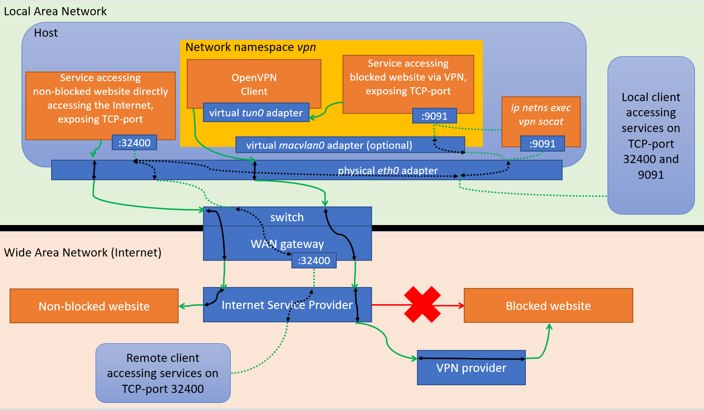

# OpenVPN Network Namespaces - openvpn-netns

When an ISP actively blocks websites or services, a VPN connection can be used to bypass those restrictions. With **openvpn-netns**, only selected applications are routed through the VPN while the rest of the system continues to use the normal ISP connection.

This allows you to:

- keep normal LAN and Internet connectivity
- selectively route specific services through the VPN
- optionally expose those VPN-routed services on the LAN

This project demonstrates such a setup on a **Raspberry Pi** using **Surfshark OpenVPN configuration files**, but it works with any OpenVPN provider.

⚠️ This setup requires **root privileges**.



In the example above:

- normal services remain reachable via the ISP
- VPN-routed services (e.g. Transmission on port **9091**) run inside a network namespace
- optional **macvlan** networking allows exposing those services to the LAN using a dedicated IP

## Compatibility

The script relies on Linux network namespaces and OpenVPN hook scripts.

It has been verified to work with:

| Component | Tested Version |
|---|---|
| Linux kernel | 6.1 (Raspberry Pi OS) |
| OpenVPN | 2.6.x |
| iproute2 | 6.x |
| systemd | 252 |

The script should also work on earlier kernels and OpenVPN versions (≥2.4), but newer distributions may require the systemd service override described below due to sandboxing restrictions.

# How it Works

When OpenVPN starts, the `netns.sh` script is executed via OpenVPN's `up`, `route-up`, and `down` hooks.

The script performs the following actions.

## 1. Establish VPN tunnel

OpenVPN creates a virtual network interface:

```
tun0
```

This interface carries encrypted VPN traffic.

## 2. Create network namespace

The script creates a dedicated Linux network namespace:

```
vpn
```

Network namespaces isolate routing tables, interfaces and firewall rules.

Applications running inside the namespace only see the interfaces configured there.

## 3. Move VPN tunnel

The VPN interface is moved into the namespace:

```
tun0 → vpn namespace
```

All traffic inside the namespace automatically exits through the VPN.

## 4. Configure networking inside the namespace

Inside the namespace the script configures:

- loopback interface
- tunnel IP address
- default route via `tun0`
- DNS configuration

Example namespace layout:

```
vpn namespace
├─ lo
└─ tun0
```

## 5. Optional LAN exposure using macvlan

An optional **macvlan** interface can be enabled in the script:

```
macvlan0
```

Example IP:

```
192.168.0.50
````

This allows services running inside the namespace to be accessed from the LAN.

⚠️ Important:

- Linux hosts normally **cannot reach their own macvlan interface**
- access must come from **another device on the LAN**

The macvlan configuration is **disabled by default** in the script.

## 6. Shutdown behavior

When OpenVPN stops:

- `tun0` disappears
- the `vpn` namespace is removed
- optional `macvlan0` is removed

# Installation

## 1. Install OpenVPN

Example for Debian / Raspberry Pi OS:

```bash
sudo apt install openvpn
````

## 2. Install VPN configuration

Download configuration files from your VPN provider.

Example:

```
/etc/openvpn/client/ch-zur.prod.surfshark.comsurfshark_openvpn_udp.conf
```

## 3. Create credentials file

```
/etc/openvpn/credentials.txt
```

Example:

```bash
echo "USERNAME" > /etc/openvpn/credentials.txt
echo "PASSWORD" >> /etc/openvpn/credentials.txt
```

## 4. Configure OpenVPN hooks

Add these lines to your OpenVPN configuration file:

```
script-security 2
auth-user-pass /etc/openvpn/credentials.txt

route-noexec
route-nopull

ifconfig-noexec

up /etc/openvpn/netns.sh
route-up /etc/openvpn/netns.sh
down /etc/openvpn/netns.sh
```

# Systemd Service Configuration

Modern OpenVPN packages enable **systemd sandboxing**, which prevents namespace creation unless permissions are adjusted.

Create an override:

```bash
sudo systemctl edit openvpn-client@<CONFIG_NAME>
```

Example:

```
openvpn-client@ch-zur.prod.surfshark.comsurfshark_openvpn_udp
```

Add:

```
[Service]
CapabilityBoundingSet=CAP_IPC_LOCK CAP_NET_ADMIN CAP_NET_RAW CAP_SETGID CAP_SETUID CAP_SETPCAP CAP_SYS_CHROOT CAP_DAC_OVERRIDE CAP_SYS_ADMIN
AmbientCapabilities=CAP_NET_ADMIN CAP_NET_RAW CAP_SYS_ADMIN

PrivateMounts=no
PrivateTmp=false

ProtectSystem=false
ProtectHome=false
```

Reload systemd:

```bash
sudo systemctl daemon-reexec
sudo systemctl daemon-reload
```

# Installing the Namespace Script

Copy the script:

```
/etc/openvpn/netns.sh
```

Make it executable:

```bash
chmod +x /etc/openvpn/netns.sh
```

# Starting OpenVPN

Start the service:

```bash
sudo systemctl start openvpn-client@<CONFIG_NAME>
```

Verify namespace creation:

```bash
ip netns list
```

Example output:

```
vpn
```

Test connectivity:

```bash
sudo ip netns exec vpn ping 8.8.8.8
```

# Running Applications in the Namespace

Run commands inside the namespace:

```bash
sudo ip netns exec vpn <command>
```

Example:

```bash
sudo ip netns exec vpn traceroute google.com
```

# Running Services

Example systemd configuration:

```
ExecStart=/sbin/ip netns exec vpn <service command>
```

# Running Docker Containers Through the VPN Namespace

Docker containers can also use the VPN namespace.

Architecture:

```
Host
 ├─ openvpn
 ├─ namespace vpn
 │   └─ tun0
 └─ docker container
     └─ ip netns exec vpn <application>
```

## Docker Compose Example

```yaml
services:
  transmission:
    build: .
    container_name: transmission
    privileged: true
    network_mode: host

    volumes:
      - /opt/transmission:/config
      - /var/run/netns:/var/run/netns

    restart: unless-stopped
```

Key settings:

| Setting              | Purpose                                  |
| -------------------- | ---------------------------------------- |
| `network_mode: host` | allows container networking through host |
| `/var/run/netns`     | exposes namespaces to container          |
| `privileged: true`   | allows `ip netns exec`                   |

## Starting Applications in the Namespace

Inside the container start applications using:

```
ip netns exec vpn <application>
```

Example:

```
ip netns exec vpn transmission-daemon -g /config -f
```

## Verifying VPN Routing

Inside the container:

```
docker exec -it transmission ip route
```

or:

```
docker exec -it transmission ip netns exec vpn ip route
```

Expected output:

```
default dev tun0
```

# Exposing Services on the LAN

If macvlan is enabled, services become reachable via its IP:

```
http://192.168.0.50:9091
```

Alternatively expose ports using `socat`:

```bash
sudo socat tcp-listen:9091,fork,reuseaddr exec:'ip netns exec vpn socat STDIO tcp-connect:127.0.0.1:9091'
```

# Accessing macvlan from the Host (Optional)

Linux hosts normally cannot communicate with their own macvlan interfaces.

To allow host access, create a secondary macvlan interface on the host:

```bash
ip link add macvlan-host link eth0 type macvlan mode bridge
ip addr add 192.168.0.51/24 dev macvlan-host
ip link set macvlan-host up
```

The host can then reach namespace services via `192.168.0.50`.

# Example Network Layout

Host:

```
eth0
lo
```

Namespace:

```
vpn
 ├─ lo
 └─ tun0
```

Example:

```bash
ip netns exec vpn ip link
```

Output:

```
lo
tun0
```

# Example OpenVPN Log Output

```
TUN/TAP device tun0 opened
/etc/openvpn/netns.sh tun0 1500 0 10.8.8.23 255.255.255.0 init
vpn netns script called - up
dev=tun0 mtu=1500 ip=10.8.8.13 mask=255.255.255.0
reset namespace
enable loopback
move tun interface into namespace
configure tun interface
configure default route
configure DNS
create macvlan
vpn namespace ready
route-up called - nothing to do
Initialization Sequence Completed
```

# Notes

* Only applications started inside the namespace use the VPN.
* The host continues to use the normal ISP connection.
* macvlan interfaces are reachable from LAN devices but not from the host unless a host macvlan is created.